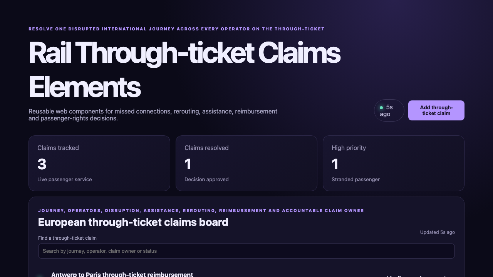

# Rail Through-ticket Claims Elements

## One-sentence benefit

Resolve disrupted international rail journeys through one accountable passenger claim.

## Live demo

[Watch the workflow](docs/demo.webm).

## Screenshots

## Main features

- Search and sort claims by journey, operator, owner, status or priority.
- Create missed-connection claims and advance real backend records.
- Summarise live case volume, resolved claims and stranded-passenger priorities.
- Expose reusable status-card and claims-desk web components.

## Technology used

Lit, TypeScript, native Web Components, reactive controllers, Vite, Spring Boot and Java 21.

## Installation instructions

Install Node.js 22 and Java 21. Run `npm install`, start `cd backend && mvn spring-boot:run`, then run `npm run dev`.

## Commercial licensing/contact

Commercial licensing and integration support are available through the repository contact options.

## Business problem and users

Passengers, railway undertakings and claims teams need one case across operators when an international through-ticket journey is disrupted.

## Key workflows

Find a claim, create a missed-connection request, assign the rights team, advance the decision and verify the API response.

## Lit and Web Components highlights

Lit reactive properties render server state, a controller supplies freshness text, keyed repeat updates rows and custom elements remain portable.

## Java backend highlights

Spring Boot implements validated list, search, create and update endpoints, structured errors, service separation, health status and tests.

## Architecture and state flow

The claims element calls `/api/items`; Java validates and updates records, then Lit renders the returned authoritative state.

## Accessibility and responsive behaviour

Labelled search, semantic articles, live status text, strong contrast, keyboard buttons and responsive components support varied screens.

## Verification commands

Run `npm test`, `npm run lint --if-present`, `npm run build`, `cd backend && mvn test` and `cd backend && mvn package`.

## Structure

`src` contains custom elements, `backend` contains Java and `docs` contains inspected media.

## Tradeoffs

Memory records keep the demonstration simple; production requires ticket validation, operator identity, payments and evidence retention.

## Roadmap

Add ticket ingestion, operator hand-offs, delay evidence, assistance expenses, multilingual notices and payment tracking.
